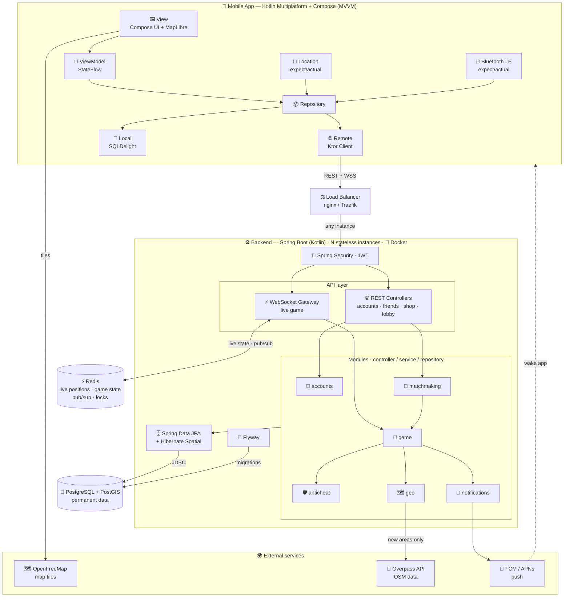

# taggd

**Team:** Erik, Almir, Lukas, Julian **Architecture diagram:** [[#10.1 Overview|§10.1]]

---

## 1. Concept

taggd is a **location-based game (LBG)**: "tag", but on the scale of a city district. Played **on foot only**.

|Role|Sees|Goal|
|---|---|---|
|**Hunter**|Hunted players as **pings** (location snapshots), every 2 min by default, faster when close (see [[#3.1 Dynamic pings\|§3.1]])|Tag every hunted player|
|**Hunted**|Hunters **live** at all times|Survive as long as possible|

Everyone sees their **own live location** and the pings/positions their role allows.

---

## 2. Game modes

| |Private|Public|Ranked|
|---|---|---|---|
|Who joins|Invited friends only|Matchmaking|Matchmaking|
|Settings|Host can change everything|Static|Static|
|Leaving|Anytime|Anytime|Not allowed → counts as a loss + Elo penalty|
|Coin gain|❌ none|✅ kept even when leaving early|✅|
|Dynamic matchmaking|❌|✅ join / get added to running games (first 15 min only)|❌|
|Bots|Optional, host decides|✅ fill small lobbies|❌|
|Elo|❌|❌|✅ gain / lose, ranked leaderboard|
|Focus|Friends|Socializing|Competition|

- Bots are always clearly marked as bots.
- **Public games:** if every hunter leaves, a bot hunter takes over, so the game can continue.
- Elo gain is relational, like the coin system: beating stronger players gives more (see [[#5.1 Elo|§5.1]]).

---

## 3. Core mechanics

- **Hunter ratio:** 30% of players are hunters by default.
- **Tagging:** the hunter gets close, then **locks on** by holding the tag button. The tag counts only if **Bluetooth** confirms the two phones are within a few meters for the whole lock-on. The hunted gets a **lock-on warning**. Details: [[#3.3 Tagging (lock-on)|§3.3]].
- **Bluetooth required:** Bluetooth must be on to join a game. The app checks this in the lobby.
- **Tagged players** leave the game and keep the coins they earned.
- **Win conditions:**
    - **Hunters win** when every hunted player has been tagged.
    - **Hunted win** when at least one of them survives until the timer ends.
- **Game timer:** max 60 min. A big timer is the centerpiece of the game screen.

### 3.1 Dynamic pings

Each hunter gets pings for each hunted player. The interval depends on the distance between that hunter and that hunted player:

|Distance|Ping every|
|---|---|
|> 500 m|2 min (default)|
|250–500 m|1 min|
|100–250 m|30 s|
|< 100 m|15 s|

Easy to remember: **closer by half → pings twice as fast.** It never goes below 15 s, so the hunted can still escape at close range.

### 3.2 Location update rate

This is how often phones **send** their position. It is separate from how often others **see** it.

|Player|Sends every|Shown to others|
|---|---|---|
|Hunter|3 s|Hunted see hunters live|
|Hunted, no hunter within 250 m|10 s|Hunters see only pings ([[#3.1 Dynamic pings\|§3.1]])|
|Hunted, a hunter within 250 m|3 s|Hunters see only pings ([[#3.1 Dynamic pings\|§3.1]])|

- The server tells each hunted client which rate to use.
- **Distance filter:** skip an update if the player moved less than 5 m, but send at least every 30 s as a heartbeat.
- **Fresh position on lock-on:** when a lock-on starts, the server asks the hunted player's phone for a new GPS fix and waits up to 3 s. If none arrives, it uses the last position, but only if it's under 10 s old.

### 3.3 Tagging (lock-on)

GPS alone is too rough for a real tag: two phones can each be 5–10 m off. So tagging uses two steps. Easy way to remember it: **GPS says "same street", Bluetooth says "arm's length".**

**Flow**

1. **Pre-filter (GPS):** the tag button activates when the server sees a hunted player within **30 m** of the hunter. The target is the nearest hunted player. Both phones are told (`lock_available`), so a locked iPhone can connect to the hunter's phone ahead of time (see Bluetooth design below).
2. **Lock-on starts:** the hunter **holds** the tag button.
3. **Lock-on warning:** the hunted player's phone immediately vibrates, plays a warning sound and shows "🔒 Someone is locking on!", with the hunter highlighted on the map. This is their last chance to run.
4. **Bluetooth check:** for the whole lock-on, the phones report the Bluetooth signal strength to the server. It must stay above the "close" threshold (≈ 3 m). A report from **either** phone counts (see "Who hears whom" below).
5. **Tagged:** after **2 s** of continuous lock-on, the server validates and confirms the tag.

**Lock-on breaks** (→ "lock lost" for both players) when:

- the hunter releases the button,
- the Bluetooth signal drops below the threshold,
- the hunted enters a safe zone or activates immunity.

After a broken lock-on, the hunter waits **5 s** before locking on again, so the button can't be spammed.

**Lock-on is not possible** on a hunted player who is in a safe zone or immune.

**Bluetooth design**

- The server gives every player a **random 8-byte code that changes every 30 s**. Phones make their current code available over Bluetooth and collect the codes of nearby players.
- Only the server knows which player a code belongs to. Each code is valid only for the current game and the current and previous 30 s window.
- **One schema for Android and iOS.** Every phone does the same three things for the whole game:

|Part|Content|Sent by|
|---|---|---|
|**Advert**|Fixed taggd service UUID (the same for every player), connectable|Android + iOS|
|**Scan response**|The current code (as service data)|Android only: iOS apps can't send service data|
|**GATT service**|One **read-only** value: the current code|Android + iOS|

  *GATT* is the part of Bluetooth Low Energy for short connections: one phone connects to another and reads a value from it. It's still Bluetooth, just a connection instead of only listening to broadcasts.

- **Why a fixed UUID:** iOS limits what apps can do over Bluetooth:
    - an iOS app can only broadcast a name and service UUIDs, no other data;
    - a locked iPhone only broadcasts inside Apple's hidden "overflow area", which carries no code, so Android phones can't tell whose phone it is;
    - a locked iPhone can only scan for **exact, known** UUIDs.

  So the UUID must be fixed, and the code travels in the scan response or over a short GATT connection.
- **Listening:** every phone scans for the fixed UUID.
    - Code in the scan response → use it directly (no connection).
    - No code (the other phone is an iPhone) → connect, read the code, disconnect. The code is reused for 10 s per device; the signal strength comes from the following scans.
    - A **locked iPhone** gets too few scan results in the background, so during a lock-on it keeps the connection to the hunter's phone open and reads the signal strength over it.
- **No modes:** no phone has to know the other's platform. Both directions run in parallel all game; the server accepts a report from either phone.

**Who hears whom** (the hunter's app is always open, since the hunter holds the tag button):

|Hunter|Hunted|Who hears whom|
|---|---|---|
|Android|Android|Both directions, code from the scan response|
|Android|iPhone, app open|Both directions; the Android phone reads the iPhone's code over GATT|
|iPhone|Android|Both directions; the Android phone reads the iPhone's code over GATT|
|Android or iPhone|iPhone, **locked**|**Only the hunted iPhone** hears the hunter and reads the hunter's code over GATT|

- **Timing:** a locked iPhone can take several seconds to discover a phone, longer than the 2 s lock-on. Phones scan during the whole game, so they usually know each other before the lock-on; on `lock_available` a locked iPhone also opens the connection to that hunter, so it's ready when the lock-on starts.
- The "close" threshold is calibrated per device type, including phones in pockets and bags.

---

## 4. Extra mechanics

- **Moving safe zones**: hunted can't be tagged inside.
- **Moving no-go zones**: a player inside one gets a **30 s** countdown to leave. Still inside when it ends → disqualified. This also covers zones that move over a player.
- **Shrinking storm**: pushes players together and ends games. Its center moves during the game, so no fixed spot stays safe (see "Camping" in [[#8. Safety & anti-cheat|§8]]). A player outside the storm circle gets the same **30 s** countdown → disqualified.
- **Spectator mode**: the spectator feed is delayed, so spectators can't feed positions to players ("ghosting").
- **Power-ups**, max one per type per game:

|Power-up|For|Effect|
|---|---|---|
|Immunity|Hunted|1 min can't be tagged|
|Invisibility|Hunter, Hunted|5 min hidden|
|Extra range|Hunter|1 min: lock-on works from farther away (pre-filter 60 m, Bluetooth threshold ≈ 8 m)|
|Ghost ping|Hunted|The hunted places a marker on the map, max 500 m from their real position. Every hunter receives **one** ping at that fake location, looking exactly like a real ping.|
|No-go zone|Hunter|The hunter places a no-go zone on the map, e.g. over a building. Players inside get the usual **30 s** countdown to leave. Forces hunted players out of their houses. Size and duration TBD.|

- **Onboarding**: welcome screens that teach the game.
- **Voice lines** for key actions.

---

## 5. Progression & social

- Accounts with a **leveling system**.
- **Achievements**.
- **Friends** via friend code or QR code.
- **Coins**, earned for:
    - **distance moved** (not time survived, so camping at home earns nothing)
    - tagging players
    - completing a game
    - **close calls**: staying within **75 m** of an opposite-role player for **10 s** without a tag. At most one reward per player pair every 2 min, so it can't be farmed.
- **Shop** for power-ups and cosmetics:
    - location marker cosmetics
    - account lobby / profile cosmetics (like Discord)
    - rank badges from the Elo system
- **In-game live chat**.

### 5.1 Elo

Standard Elo, adapted for teams. Each player is compared against the **average Elo of the other team**:

```
expected = 1 / (1 + 10^((opponentAvg - playerElo) / 400))
change   = K × (score - expected)
```

| |score|
|---|---|
|Hunted, survived|1|
|Hunted, tagged|0|
|Hunter|share of hunted tagged (e.g. 3 of 4 → 0.75)|
|Left a ranked game|0 (counts as a loss)|

- **K = 32** for a player's first 20 ranked games (placement, moves fast), **K = 16** after that.
- Easy to remember: **win against stronger players → big gain; lose against weaker players → big loss.**
- **Role balance:** win rates per role are monitored. If one role wins much more often, the scores or K are adjusted per role.

---

## 6. Monetization

All options are **potential**. The final model is still TBD.

|Option|Idea|Status|
|---|---|---|
|Buying coins|Real money → coins for the shop|Potential|
|Battle pass|Seasonal reward track with a free and a paid tier (cosmetics, coins)|Potential|
|Pro subscription|Monthly perks, e.g. exclusive cosmetics, bonus coins, extended private-game settings, match history|Potential|
|Loot boxes|Random cosmetics|Potential|

- **Loot boxes carry legal risk:** paid loot boxes are banned in Belgium and have been ruled gambling in Austrian court cases. Get legal advice before implementing them. If used: cosmetics only, with drop rates shown.

---

## 7. Style

- Playful, in the style of Duolingo's theme.

---

## 8. Safety & anti-cheat

**Player safety**

- Players who enter restricted or dangerous areas (motorways, railways, water, …) get an immediate warning and a **15 s** countdown; still inside → disqualified. The countdown prevents false disqualifications from GPS jitter next to a road. Source: OSM, see [[#10.6 Geospatial|§10.6]].
- Safety hints (watch traffic, stay on sidewalks, …).
- Minimum age: 14 (Austria's GDPR age of digital consent); younger players need parental consent.

**Anti-cheat**

- **The server is the authority.** Clients only send positions and actions; the server decides everything else.
- **The server filters what each client receives.** Hunters never get live positions of the hunted, only pings. A modified app can't reveal what it never received.
- **On foot only:** speed checks (distance ÷ time between updates) flag anything above **25 km/h**, which rules out bikes, scooters and vehicles. Updates with bad GPS accuracy are ignored.
- **Tag validation:** the server checks the GPS pre-filter, that the Bluetooth codes are valid for this game, player and time window, that the signal stayed above the threshold for the full 2 s (reported by either phone), and that the target wasn't immune or in a safe zone.
- **Code replay:** a code that is expired or belongs to a different game or player → rejected and flagged.
- **Code relay** (an accomplice next to the victim passes their code on to a hunter far away): codes rotate every 30 s, the code's owner must be within the GPS pre-filter range of the reporting player, and the signal must stay plausible for the full 2 s.
- **Signal strength cross-check:** phones report signal strength themselves, so a modified hunter app could report a stronger signal than it really measured (e.g. hear the victim from 30 m and claim arm's length). The signal between two phones is roughly the same in both directions, so when both phones report, the server compares the values: a hunter whose values are consistently much stronger than the hunted's → **flagged**. With a locked iPhone only the hunted reports, and the hunted has no reason to inflate the signal.
- **Bluetooth heartbeat:** during a game every phone sends a `ble_report` every **5 s** with everything it heard. This closes the gap of a locked iPhone, where **only the hunted's phone** delivers the Bluetooth evidence (see [[#3.3 Tagging (lock-on)|§3.3]]): a modified app could simply stay silent and become untaggable.
    - A hunted player whose phone reports nothing while a hunter is next to them by GPS → **flagged**.
    - Extra evidence: the hunter's Android phone can see the iPhone's hidden "overflow area" broadcast. It doesn't say who, but it proves that a taggd iPhone is nearby. This relies on an undocumented Apple format, so it only strengthens a flag and never decides a tag on its own.
    - Repeated flags → warning, then the normal ban process.
- **Camping:** hiding at home for the whole game should not be a viable strategy.
    - Coins are earned for distance moved, not time survived ([[#5. Progression & social|§5]]).
    - The storm's center moves, so no fixed spot stays safe ([[#4. Extra mechanics|§4]]).
    - Hunters have a **no-go zone** power-up to force hunted players out of a building ([[#4. Extra mechanics|§4]]).
- Anti-tampering for the frontend.
- Bans and chat moderation.

**Bluetooth safety**

- **Changed from the first design:** it said phones "never connect or pair". That was dropped, because a locked iPhone can only get a code over a connection (see [[#3.3 Tagging (lock-on)|§3.3]]). Connections are allowed, but tightly limited:
    - the GATT service offers exactly **one read-only value** (the current code); writes and every other request are refused;
    - **no pairing, no bonding**;
    - the reader disconnects right after reading; only a locked iPhone in an active lock-on keeps the connection open to measure signal strength;
    - connection attempts are **rate-limited per device**, so nobody can drain the battery or block connections.
- Reading the code over GATT reveals nothing new: the same code is broadcast openly anyway.
- The broadcast contains **only** the fixed taggd UUID and the random, rotating code: no name, no account ID. Nobody outside the server can link it to a person.
- Bluetooth broadcasting, scanning and the GATT service run **only during an active game** and stop automatically afterwards.
- Permissions:
    - **Android:** "Nearby devices" (scan, advertise, connect), declared as **not** used for location; notifications (see §10.2, Background & notifications).
    - **iOS:** Bluetooth.
    - The permission prompts explain that Bluetooth is only used for tagging.

**Battery**

- Rely on push notifications; only render map data while the screen is on.
- Location updates are still sent while the screen is off, since the server needs them. On iOS this requires the "Always" location permission, which the App Store reviews strictly. On Android the game runs in a foreground service (see §10.2, Background & notifications).

---

## 9. Privacy (GDPR)

Location data is personal data, so **no location history is stored**. Only what a feature actually needs is kept:

|Data|Why|Kept|
|---|---|---|
|Live positions (Redis)|Running the game|Deleted when the game ends|
|Both positions at a tag (`tags`)|Proof that a tag was valid|Coordinates removed after 30 days|
|Bluetooth codes (Redis)|Proximity check for tagging|Random, rotate every 30 s, deleted when the game ends|
|Latest Bluetooth report per player (Redis)|Tag validation, Bluetooth heartbeat check|Only the latest report, deleted when the game ends|
|Evidence around a cheat flag (`anticheat_flags`)|Reviewing flags, ban appeals|30 days, or until the appeal is resolved|
|Distance walked per game (`game_players`)|Stats and achievements|A single number, no coordinates|
|Chat messages (Redis)|In-game chat|Deleted when the game ends|
|Reported chat messages (`chat_reports`)|Moderation|Until the report is resolved|

- **Fixed Bluetooth UUID:** anyone with a Bluetooth scanner can tell that **someone nearby is playing taggd**, but not who: the phones' Bluetooth addresses change regularly and only the server can resolve the code. It is only broadcast during an active game.
- A privacy policy and in-app consent for location tracking and Bluetooth are required, reviewed before public release.

---

## 10. Architecture

### 10.1 Overview

**Modular monolith**: one Spring Boot codebase, split into modules by concern, deployed as **N identical, stateless instances** behind a load balancer.



**How it scales:** instances hold no state, so scaling means starting more copies of the same Docker image. For development and the first release, one instance is enough.

### 10.2 Frontend: Kotlin Multiplatform + Compose

**Pattern: MVVM**

|Layer|Job|
|---|---|
|**View**|Compose UI and MapLibre map. Shows state, forwards user actions.|
|**ViewModel**|Holds UI state (`StateFlow`), survives screen rotation.|
|**Repository**|Single source of truth; combines remote, local and location data.|
|**Remote / Local**|Ktor Client / local database.|

**Package structure**

```
model/
  remote/     map, account      ← Ktor API + WebSocket clients, DTOs
  local/      map, account      ← local DB, settings
view/         map, account      ← Compose screens
viewmodel/    map, account
di/           Koin modules
```

**Libraries**

|Purpose|Library|
|---|---|
|Dependency injection|Koin|
|Map rendering|MapLibre Compose|
|HTTP + WebSocket|Ktor Client|
|Local DB (caches)|SQLDelight|
|Key-value settings|multiplatform-settings|
|JSON|kotlinx.serialization|
|Location|`expect/actual` wrapper around Google Play Location Services (Android) and Core Location (iOS)|
|Bluetooth LE|`expect/actual` wrapper around Android's Bluetooth LE APIs and iOS Core Bluetooth (broadcast + scan + read-only GATT service, see [[#3.3 Tagging (lock-on)\|§3.3]])|

**Background & notifications**

The game must keep running with the screen off and the phone in a pocket.

- **Android:** the game runs in a **foreground service** (types `location` + `connectedDevice`). Without it, Android cuts network access for minimized apps: in the proof of concept, server requests timed out as soon as the app was minimized ([[#11.1 Bluetooth proof of concept|§11.1]]).
- **iOS:** background modes `location` (keeps the app running, see [[#8. Safety & anti-cheat|§8]]), `bluetooth-central` and `bluetooth-peripheral`.
- Android requires a **visible notification** for every foreground service. Instead of hiding it, taggd makes it a **live game notification**:
    - the game timer as a countdown (the system runs it, no updates needed)
    - own role and players left
    - hunters: countdown to the next ping; hunted: "hunter within 250 m"
    - updated on game events, not every second
- **Android 16+:** requested as a **Live Update** (promoted notification on the lock screen, status bar chip with the timer or 🔒). Google only allows this for ongoing, time-sensitive activities, so it depends on Google accepting a game round; otherwise it stays a normal ongoing notification.
- **iOS:** a **Live Activity** (lock screen + Dynamic Island). It must be written in Swift (widget extension), since Compose can't render it; the shared code only starts, updates and ends it. Updates come from the app or via APNs push. Maximum runtime ~8 h, enough for 60-min games.
- **Lock-on warning:** its own high-priority notification channel (pop-up + vibration), separate from the quiet live notification.

### 10.3 Backend: Spring Boot (Kotlin)

**Pattern: packages grouped by concern.** Each module has its own controller / service / repository:

```
game/
  GameController.kt     ← REST / WebSocket endpoints
  GameService.kt        ← game logic
  GameRepository.kt     ← database access
  model/                ← entities + DTOs
```

**Modules**

|Module|Responsibility|
|---|---|
|`accounts`|Accounts, levels, friends, coins, Elo, achievements, shop|
|`matchmaking`|Public / ranked / private lobbies, dynamic joining, bots|
|`game`|Live game loop: tagging, ping timing, storm, zones, power-ups, chat|
|`anticheat`|Speed checks, tag validation, flags and bans|
|`geo`|Restricted-area data from OSM, cached in PostGIS|
|`notifications`|Push notifications via FCM / APNs|

**Rules**

1. Instances are stateless: live state goes in Redis, permanent data in Postgres.
2. A module never uses another module's repository; it calls that module's service. This keeps modules separable.
3. Each game's loop (storm ticks, ping timers) runs on exactly one instance, which holds a lock in Redis. If that instance dies, another one takes the game over.

**Other components**

- **Spring Security** with JWT authentication.
- **Spring Data JPA** + **Hibernate Spatial** (JTS geometry types).
- **Flyway** runs DB migrations on startup.

### 10.4 Communication

|Channel|Used for|
|---|---|
|**REST** (HTTPS)|Normal data: accounts, friends, shop, lobbies, history|
|**WebSocket** (WSS)|Live games, see message list below|
|**Push** (FCM / APNs)|Game start, "a hunter is close", tagged, game over, friend invites|

**WebSocket messages**

- Client → server: `location_update`, `lock_start`, `lock_release`, `ble_report` (codes heard + signal strength; every 5 s as heartbeat, continuously during a lock-on), `use_powerup`, `chat`
- Server → client: `hunter_positions` (live), `hunted_ping` (at the ping interval), `ble_code` (next rotating code), `lock_available` (target within 30 m; sent to hunter and hunted), `lock_on_warning` (to the hunted), `lock_lost`, `tagged`, `zone_update`, `storm_update`, `game_over`, `chat`

Send rates: see [[#3.2 Location update rate|§3.2]]. The server receives hunted positions frequently for tag checks and close calls, but only reveals them to hunters at the ping interval.

### 10.5 Data

**Rule of thumb: Redis = what's happening right now. Postgres = what must still exist tomorrow.**

#### Redis (live, temporary)

All `game:{id}:*` keys are deleted when the game ends.

```mermaid
flowchart LR
    subgraph GAME["Per game · deleted at game end"]
        direction TB
        G_STATE["game:{id}:state<br/>HASH<br/>status · ends_at · storm center + radius"]
        G_PLAYERS["game:{id}:players<br/>HASH<br/>playerId → role · status · platform"]
        G_HUNTERS["game:{id}:hunters<br/>GEO<br/>live hunter positions"]
        G_HUNTED["game:{id}:hunted<br/>GEO<br/>live hunted positions"]
        G_FIX["game:{id}:lastfix<br/>HASH<br/>playerId → timestamp · accuracy · speed"]
        G_PINGS["game:{id}:pings<br/>ZSET<br/>hunter:hunted → next ping due"]
        G_POWER["game:{id}:powerups<br/>HASH<br/>playerId → used types · active effect"]
        G_COUNT["game:{id}:countdowns<br/>HASH<br/>playerId → reason · deadline"]
        G_LOCKON["game:{id}:lockons<br/>HASH<br/>hunterId → target · started_at"]
        G_BLE["ble:{id}:{code}<br/>STRING · TTL 60 s<br/>code → playerId"]
        G_HEARD["game:{id}:heard<br/>HASH<br/>playerId → latest ble_report"]
        G_CHAT["game:{id}:chat<br/>LIST<br/>last 100 messages"]
        G_CC["closecall:{id}:{a}:{b}<br/>STRING · TTL 2 min<br/>close-call cooldown"]
        G_LOCK["lock:game:{id}<br/>STRING · TTL 10 s, renewed<br/>owning instance"]
        G_EVENTS["game:{id}:events<br/>PUB/SUB channel"]
    end

    subgraph GLOBAL["Global"]
        direction TB
        MM_WAIT["mm:{mode}:waiting<br/>GEO<br/>players waiting for a match"]
        MM_TIME["mm:{mode}:joined<br/>ZSET<br/>userId → queue join time"]
        PRES["presence:{userId}<br/>STRING · TTL 60 s<br/>online status"]
        RATE["rate:{userId}:{action}<br/>STRING · TTL<br/>chat / request rate limit"]
    end
```



|Key|Type|Content|Lifetime|
|---|---|---|---|
|`game:{id}:state`|HASH|Status, mode, `ends_at`, storm center + current radius, zone states|Game|
|`game:{id}:players`|HASH|`playerId` → role, status (active / tagged / left / disqualified), is bot, platform (android / ios)|Game|
|`game:{id}:hunters`|GEO|Latest hunter positions; supports "who is within X m" queries|Game|
|`game:{id}:hunted`|GEO|Latest hunted positions|Game|
|`game:{id}:lastfix`|HASH|`playerId` → timestamp, GPS accuracy, speed (GEO sets can't store these)|Game|
|`game:{id}:pings`|ZSET|Member `hunterId:huntedId`, score = time the next ping is due|Game|
|`game:{id}:powerups`|HASH|`playerId` → power-up types used, active effect + expiry|Game|
|`game:{id}:countdowns`|HASH|`playerId` → reason (no-go / storm / restricted), deadline|Game|
|`game:{id}:lockons`|HASH|`hunterId` → target, lock-on start time, latest signal strengths; also the 5 s cooldown|Game|
|`ble:{id}:{code}`|STRING|Rotating Bluetooth code → player it belongs to|TTL 60 s|
|`game:{id}:heard`|HASH|`playerId` → latest `ble_report` (codes heard, signal strengths, time); used for the Bluetooth heartbeat check|Game|
|`game:{id}:chat`|LIST|Last 100 chat messages (`LTRIM`)|Game|
|`closecall:{id}:{a}:{b}`|STRING|Close-call cooldown for a player pair|TTL 2 min|
|`lock:game:{id}`|STRING|Instance that runs the game loop (`SET NX PX`)|TTL 10 s, renewed|
|`game:{id}:events`|PUB/SUB|Events forwarded to every instance's WebSocket clients|—|
|`mm:{mode}:waiting`|GEO|Players waiting for a match, by location|Until matched|
|`mm:{mode}:joined`|ZSET|`userId` → queue join time|Until matched|
|`presence:{userId}`|STRING|Online status for the friends list|TTL 60 s|
|`rate:{userId}:{action}`|STRING|Counter for rate limits (chat spam, requests)|TTL per window|

#### PostgreSQL + PostGIS (permanent)

- All spatial columns use `geography` with SRID 4326 (distances in meters) and a GiST index.
- Chat is **not** stored permanently; only **reported** messages are copied into `chat_reports`.
- Retention rules: see [[#9. Privacy (GDPR)|§9]].

```mermaid
erDiagram
    users ||--o{ friendships : has
    users ||--o{ game_players : plays
    users ||--o{ push_tokens : has
    users ||--o{ refresh_tokens : has
    users ||--o{ user_achievements : unlocks
    users ||--o{ inventory : owns
    users ||--o{ coin_transactions : has
    users ||--o{ bans : receives
    games ||--o{ game_players : has
    games ||--o{ zones : has
    games ||--o{ tags : has
    games ||--o{ anticheat_flags : has
    games ||--o{ chat_reports : has
    achievements ||--o{ user_achievements : "unlocked as"
    shop_items ||--o{ inventory : "owned as"
    anticheat_flags |o--o{ bans : causes

    users {
        uuid id PK
        text username UK
        text email UK
        text password_hash
        text friend_code UK
        int level
        int xp
        int coins "cached balance"
        int elo
        int ranked_games_played "K-factor"
        timestamptz created_at
    }
    friendships {
        uuid user_id PK, FK
        uuid friend_id PK, FK
        text status "pending / accepted"
        timestamptz created_at
    }
    push_tokens {
        uuid id PK
        uuid user_id FK
        text platform "android / ios"
        text token UK
        timestamptz updated_at
    }
    refresh_tokens {
        uuid id PK
        uuid user_id FK
        text token_hash UK
        timestamptz expires_at
    }
    games {
        uuid id PK
        text mode "private / public / ranked"
        text status "lobby / running / finished"
        uuid host_id FK "private only"
        jsonb settings "host settings"
        geography center "Point"
        geography play_area "Polygon"
        float storm_start_radius_m
        float storm_end_radius_m
        timestamptz storm_start_at
        timestamptz storm_end_at
        text winner "hunters / hunted"
        timestamptz created_at
        timestamptz started_at
        timestamptz ended_at
    }
    game_players {
        uuid id PK
        uuid game_id FK
        uuid user_id FK "null for bots"
        boolean is_bot
        text role "hunter / hunted"
        text result "survived / tagged / left / disqualified"
        int coins_earned
        int xp_earned
        int elo_change
        float distance_walked_m
        timestamptz joined_at
        timestamptz left_at
    }
    zones {
        uuid id PK
        uuid game_id FK
        text type "safe / no_go"
        geography area "Polygon"
        timestamptz valid_from
        timestamptz valid_to
    }
    tags {
        uuid id PK
        uuid game_id FK
        uuid hunter_id FK
        uuid hunted_id FK
        geography hunter_pos "Point, removed after 30 days"
        geography hunted_pos "Point, removed after 30 days"
        float distance_m "GPS distance"
        int ble_rssi "average signal strength"
        text ble_reported_by "hunter / hunted / both"
        timestamptz tagged_at
    }
    anticheat_flags {
        uuid id PK
        uuid game_id FK
        uuid user_id FK
        text type "speed / tag / restricted_area / ble_silence"
        geography evidence "LineString, few points"
        text status "open / confirmed / dismissed"
        timestamptz created_at
    }
    bans {
        uuid id PK
        uuid user_id FK
        uuid flag_id FK "optional"
        text reason
        timestamptz banned_until "null = permanent"
        timestamptz created_at
    }
    chat_reports {
        uuid id PK
        uuid game_id FK
        uuid reporter_id FK
        uuid reported_id FK
        text message_text
        text status "open / resolved"
        timestamptz created_at
    }
    achievements {
        uuid id PK
        text key UK
        text name
        text description
        int xp_reward
    }
    user_achievements {
        uuid user_id PK, FK
        uuid achievement_id PK, FK
        timestamptz unlocked_at
    }
    shop_items {
        uuid id PK
        text type "powerup / marker / lobby / badge"
        text name
        int price_coins
        boolean active
    }
    inventory {
        uuid user_id PK, FK
        uuid item_id PK, FK
        int quantity
        boolean equipped
    }
    coin_transactions {
        uuid id PK
        uuid user_id FK
        int amount "+ earned / - spent"
        text reason "game_reward / shop / purchase"
        uuid ref_id "game, item or store receipt"
        timestamptz created_at
    }
    restricted_areas {
        uuid id PK
        bigint osm_id
        text category "motorway / railway / water"
        geography area
        timestamptz fetched_at
    }
    osm_coverage {
        uuid id PK
        geography bbox "Polygon already fetched"
        timestamptz fetched_at
    }
```



|Table|Purpose|
|---|---|
|`users`|Account, level, coin balance, Elo|
|`friendships`|Friend requests and friends|
|`push_tokens`|FCM / APNs device tokens for push notifications|
|`refresh_tokens`|JWT refresh tokens (hashed)|
|`games`|One row per game: mode, settings, play area, storm config, result|
|`game_players`|Who played which role and how it ended; `user_id` is null for bots|
|`zones`|Safe / no-go zones; a moving zone = several rows with time windows|
|`tags`|Proof of every tag|
|`anticheat_flags`|Suspected cheating with a small evidence trail|
|`bans`|Active and past bans|
|`chat_reports`|Copies of reported chat messages|
|`achievements` / `user_achievements`|Achievement definitions / unlocks|
|`shop_items` / `inventory`|Shop catalog / what each user owns and has equipped|
|`coin_transactions`|Ledger of every coin change; `users.coins` is the cached sum|
|`restricted_areas`|Dangerous areas from OSM|
|`osm_coverage`|Which areas have already been fetched from Overpass, so each area is only fetched once|

### 10.6 Geospatial

**Rule of thumb: the backend decides; the frontend displays and warns.**

|Task|Where|How|
|---|---|---|
|Lock-on pre-filter (30 m)|Backend|Redis GEO search around the hunter|
|Ping interval by distance|Backend|Distance between hunter and hunted|
|Close calls|Backend|Distance between opposite roles|
|Inside safe / no-go zone|Backend|`ST_Covers(zone, point)`, or JTS in memory|
|Storm|Backend|Moving center + radius shrinking over time; "outside" = distance > radius|
|Speed check|Backend|Distance ÷ time between updates|
|Nearby games (matchmaking)|Backend|`ST_DWithin(game.center, player, 5000)`|
|Restricted areas|Backend|`ST_Intersects(restricted_area, player)`|
|GPS positions|Frontend|Platform location APIs|
|Drawing map, zones, storm|Frontend|MapLibre GeoJSON layers|
|"50 m to storm edge" warnings|Frontend|Local distance calculation, for UX only|

During live games the checks run in memory (Redis / Kotlin); PostGIS is used for persistence, zones, restricted areas and matchmaking.

**Map data**

All map data comes from **OpenStreetMap** (ODbL license). The map must show the credit "© OpenStreetMap contributors"; MapLibre displays it automatically.

|Need|Service|Notes|
|---|---|---|
|Map tiles (display)|**OpenFreeMap** public instance|Worldwide, free, no API key, no request limits. Donation-funded, no uptime guarantee.|
|Restricted areas (server checks)|**Overpass API** public instance|Worldwide. Fair-use guideline: ~10,000 requests and ~1 GB per day.|

**Overpass usage**

- When a game is created, the server queries Overpass for the game's bounding box, filtered to motorways, railways, water, etc.
- The result is stored in `restricted_areas`, the fetched area in `osm_coverage`. Later games in that area reuse it; it is refreshed weekly. Overpass is only called for **new areas**, not per game or per player.
- Every request sends a `User-Agent` header identifying taggd.

**Scaling path** (when traffic grows)

|Step|Replace|With|
|---|---|---|
|1|Public Overpass|**Self-hosted Overpass** (Docker, e.g. `wiktorn/overpass-api`), fed with Geofabrik extracts for the regions where people play, auto-updated|
|2|Public OpenFreeMap|**Protomaps**: one `.pmtiles` file (whole world ~120 GB, or a region cut-out) on cloud storage like Cloudflare R2; no tile server needed|

---

## 11. Testing

- **Location simulator**: replays GPX tracks or scripted routes as fake players. Public-game bots reuse the same code.
- **Unit tests** as normal.
- **Automated game tests**: full games with simulated players, checking tags, pings, storm and scoring.
- **Integration tests** with Testcontainers (real PostGIS + Redis).
- **Load tests** with many simulated players, to check WebSocket and Redis throughput.
- **Bluetooth field tests:**
    - signal strength vs. distance (1 / 3 / 5 / 8 m; in hand, in a pocket, in a bag) per device model, to calibrate the "close" threshold;
    - background matrix: Android / iPhone × app open / locked, measuring the time until first detection.

### 11.1 Bluetooth proof of concept

A small app that tests the Bluetooth part of tagging before the real app is built.

|Part|Built with|
|---|---|
|App|Kotlin Multiplatform, shared Compose UI and Ktor client; Android target|
|Server|Flask (Python), standing in for the Spring Boot backend: hands out rotating codes (30 s), resolves heard codes to players|

**What it does:** a hunter / hunted toggle; the phone broadcasts its code and scans for other taggd phones. When it detects one, it vibrates and shows debug info: code, signal strength, rough distance, whether the code came from the scan response or over GATT, and which player and role the server resolved it to.

**Results so far**

- Detection and server resolution work between a **Pixel 7 Pro** (Android 17) and a **vivo V2109** (Android 12). The app is also installed on a **Galaxy A17** and a **Galaxy A37** (Android 16).
- Finding: Android cuts network access for minimized apps, so a **foreground service** is required (§10.2, Background & notifications). With it, the app keeps working in the background.
- The shared schema from [[#3.3 Tagging (lock-on)|§3.3]] (fixed UUID, scan response, GATT) is implemented on Android and the server, but **not field-tested yet**.

**Still open:** the iOS version (needs Xcode on a Mac), signal strength calibration, and the lock-on itself.

## 12. Deployment

- **Backend:** Docker image. Docker Compose runs the app, `postgis/postgis`, Redis, and nginx or Traefik.
- **Scaling:** increase the number of app containers (`docker compose up --scale app=3`).
- **Apps:** built for Android and iOS; optional release on Google Play and the App Store.
- **CI** (e.g. GitHub Actions): tests, Docker image build, app builds.

---

## 13. Balance values

All game-balance numbers in one place:

|Value|Setting|Section|
|---|---|---|
|Lock-on pre-filter (GPS)|30 m|[[#3.3 Tagging (lock-on)\|§3.3]]|
|Bluetooth "close" threshold|≈ 3 m, calibrated per device type|[[#3.3 Tagging (lock-on)\|§3.3]]|
|Lock-on duration|2 s|[[#3.3 Tagging (lock-on)\|§3.3]]|
|Lock-on cooldown after a break|5 s|[[#3.3 Tagging (lock-on)\|§3.3]]|
|Bluetooth code rotation|30 s|[[#3.3 Tagging (lock-on)\|§3.3]]|
|Extra-range power-up|pre-filter 60 m, Bluetooth ≈ 8 m|[[#4. Extra mechanics\|§4]]|
|Ping intervals|2 min / 1 min / 30 s / 15 s|[[#3.1 Dynamic pings\|§3.1]]|
|Location send rate|hunters 3 s, hunted 10 s (3 s near hunters)|[[#3.2 Location update rate\|§3.2]]|
|No-go zone / storm countdown|30 s|[[#4. Extra mechanics\|§4]]|
|Restricted-area countdown|15 s|[[#8. Safety & anti-cheat\|§8]]|
|Speed limit (on foot)|25 km/h|[[#8. Safety & anti-cheat\|§8]]|
|Ghost ping max distance|500 m|[[#4. Extra mechanics\|§4]]|
|Close call|75 m for 10 s, 2 min cooldown per pair|[[#5. Progression & social\|§5]]|
|Elo K-factor|32 (first 20 games) → 16|[[#5.1 Elo\|§5.1]]|
|Data retention|30 days (tags, cheat evidence)|[[#9. Privacy (GDPR)\|§9]]|